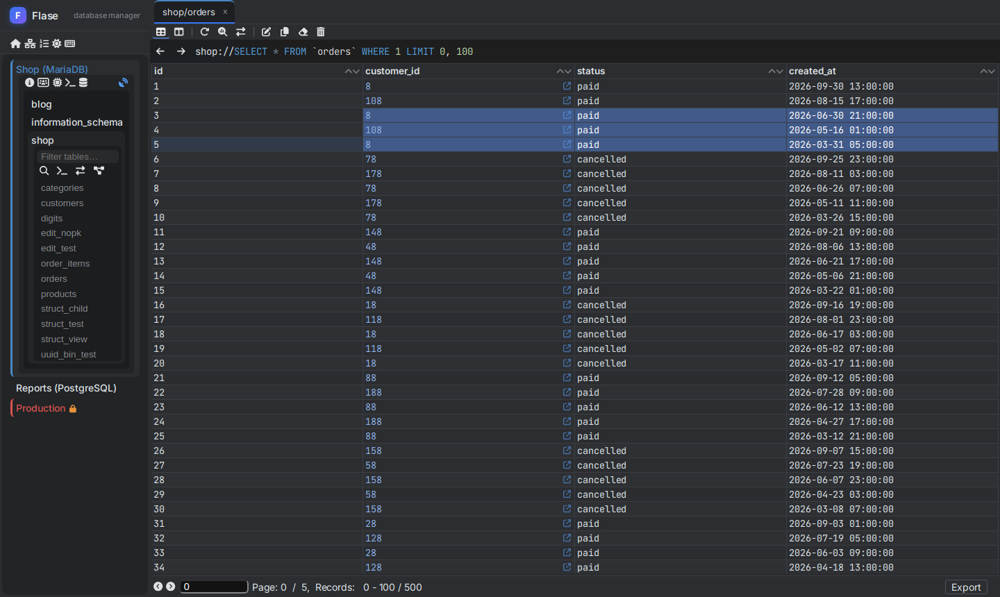
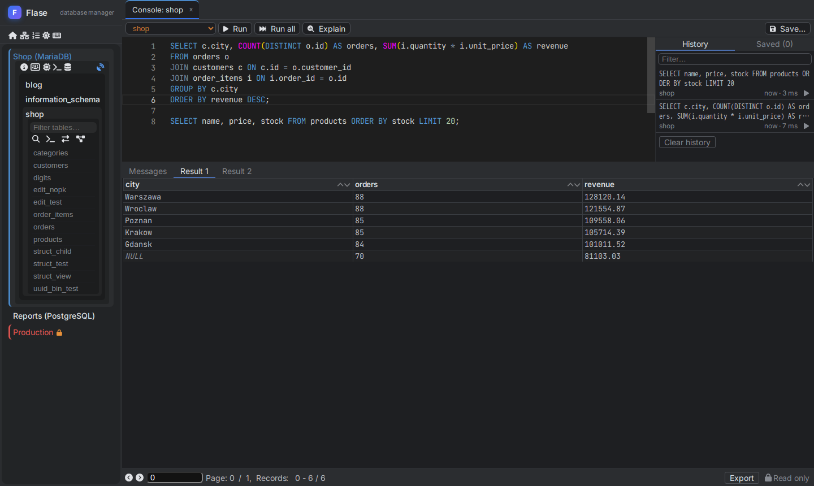
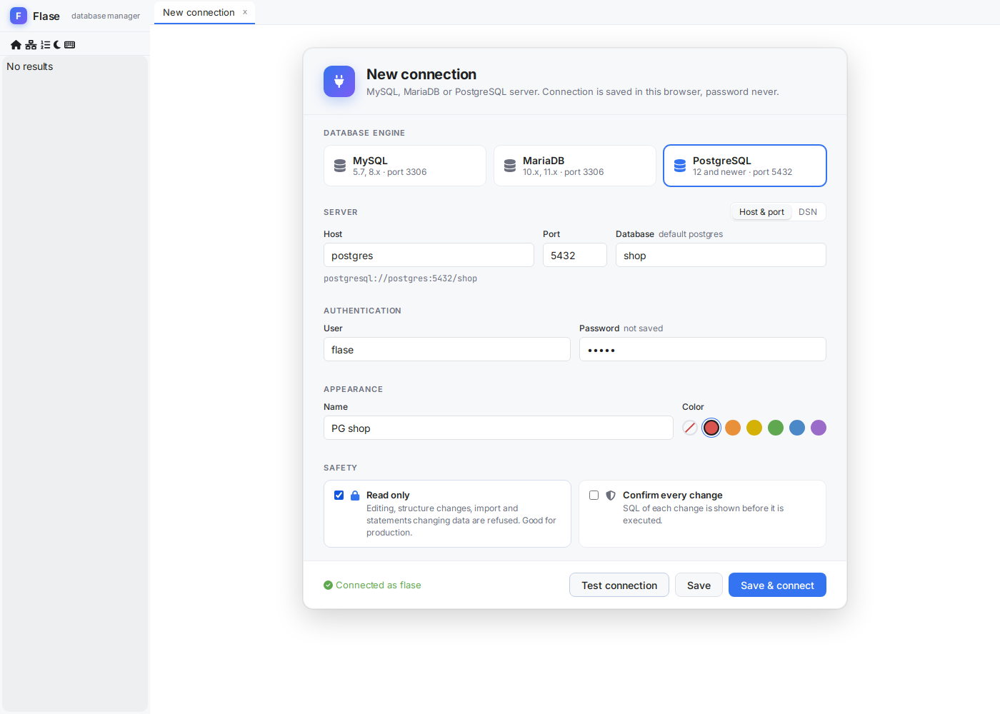

# Flase - modern web database manager, phpMyAdmin alternative

[](LICENSE)
[](https://hub.docker.com/r/backen/flase)
[](https://hub.docker.com/r/backen/flase)
[](https://buymeacoffee.com/djbacken)
[](https://buycoffee.to/djbacken)

**Flase** is a fast, open source **web-based database client** for **MySQL**, **MariaDB** and **PostgreSQL**.
It is a modern **alternative to phpMyAdmin and Adminer** with the comfort of desktop tools like DataGrip, DBeaver or HeidiSQL -
but running in the browser, in one Docker container.

Browse and edit data in a spreadsheet-like grid, change table structure with SQL preview, run queries in an SQL console,
import and export dumps, draw ER diagrams and manage users - all from one self-hosted web application.



## Why Flase

- **Made for daily work** - virtualized data grid with thousands of cells, inline editing, multi selection, keyboard shortcuts.
- **Safe for production** - read only connections enforced by the server, colored connections, SQL preview of every change.
- **Works where your database is** - deploy one container next to the database; connections can be predefined
  by administrator, so the database is reachable only from the Flase server.
- **One tool for MySQL, MariaDB and PostgreSQL** - the same UI for all three engines.

## Features

### Data grid
- Fast virtualized grid (only visible rows and columns are rendered) - comfortable with 50+ columns
- Inline cell editing (double click) and **Edit cell** popup with big text area for long texts and JSON
- Multi selection (drag, Shift + click, Ctrl + click), delete of selected rows, add / clone / edit row in a form
- Pending changes with **SQL preview**, submit with Ctrl + S, optional confirmation of every change
- Delete of rows referenced by other tables without foreign key checks (option of pending changes)
- Copy selection or whole selected rows as **TSV, CSV, JSON, XML, Markdown, HTML, LaTeX or SQL INSERT**
- Export rows as **CSV, Excel (XLSX), OpenDocument (ODS), JSON, XML, SQL, HTML, LaTeX or PDF**
- **Charts** of results (bar, line, pie, scatter, grouping) and **map** of spatial values (OpenStreetMap background)
- Foreign key navigation (open referenced row in the same or a new tab)
- Quick filters from cell values, sorting by more columns (Ctrl + click), paging, query bar with history and SQL completion
- **Find and replace** in column (text or regular expression) with preview of changed rows
- Value of **referenced row next to foreign key** (display column) and **transformations** - image, link, date from Unix time, size, yes / no
- Resizable columns (drag the header edge, double click to fit content) remembered per table
- **Count, sum, average, min and max** of selected cells in footer
- Value editor for JSON (format / minify), long texts and binary values - edited as hex, text, UUID or uploaded file
- UUID and binary (BINARY(16), bytea) primary keys, tables without primary key

### Structure
- Columns, indexes, foreign keys, triggers and DDL of tables and views
- **Create table** form - columns, primary key, indexes, engine, collation, comment
- Add, change and drop columns, indexes and **foreign keys** - **every DDL statement is previewed** before execution
- Table options - engine, collation (with conversion of columns), comment, AUTO_INCREMENT
- Rename, copy, truncate and drop tables

### Databases
- **Database overview** - tables and views with rows and sizes, procedures, functions, triggers and events
- Operations on **selected tables**: export, truncate, drop, **OPTIMIZE / ANALYZE / CHECK / REPAIR**
  (MySQL, MariaDB) or **VACUUM / ANALYZE / REINDEX** (PostgreSQL)
- Create, rename and drop databases (schemas), change collation of database and its tables
- Many databases with the same prefix (`client_a`, `client_b`…) are **grouped** in the sidebar
- **Stored procedures, functions, triggers, events and views** - create from template, edit in SQL editor, drop,
  execute procedure with parameters, create view from query

### SQL console
- Many statements in one run, results in tabs, messages with timing and affected rows
- Run statement under cursor (Ctrl + Enter) or everything (Ctrl + Shift + Enter)
- Query history and saved queries, cancel of running query (KILL QUERY / pg_cancel_backend)
- SQL completion of tables, columns and keywords (Monaco editor)
- **Execution plan as tree** - cost, rows and share of every step, full scans marked; **Analyze** shows actual rows and time
- **Parameters** `:name` - values are asked before execution
- **Inspections** - UPDATE / DELETE without WHERE is underlined and needs confirmation, unknown tables and columns are underlined



### Import / export
- Streamed **SQL dump** of databases and tables (also **gzip**), structure and / or data
- SQL and **CSV import** with progress, column mapping and preview, stop on error
- Export as text in the browser (like phpMyAdmin "view output as text") and import of pasted text

### Server
- **Live monitor** - connections, queries per second, traffic, cache hit ratio, slow queries with charts
- **Status variables** and **server variables** with change (SET GLOBAL / SET PERSIST / ALTER SYSTEM) and SQL preview
- **Advisor** - checks of buffer pool, connections, temporary tables, slow log, idle transactions, checkpoints...
- Character sets, collations, storage engines; PostgreSQL databases, access methods and extensions
- **Replication** - replicas / standbys, lag, slots, publications, binary logs with events, WAL files

### More
- **Visual query builder** - tables and joins on canvas, columns with filters, sort and aggregates, live SQL
- **ER diagram** of a database with movable layout, SVG export and drawing of relations (foreign keys)
- **Schema compare** - differences of two databases (also on other servers) and migration script of target
- **Users and privileges** - accounts, roles and GRANTs of MySQL, MariaDB and PostgreSQL
- Processlist with kill of queries, search across all tables of a database
- **Dark and light theme**, keyboard shortcuts (F1 shows all of them)
- Several servers open at once in the sidebar, tabs colored by connection
- PostgreSQL tree like pgAdmin - databases, schemas, tables (connection without database in DSN)
- **State survives reload** - open tabs (with query, sort and filter of tables and text of SQL console), open servers and databases
- **Remember password** in the browser - encrypted (AES-GCM) with a key the page cannot read, never stored on the server
- **TLS / SSL** connections to the database (`sslmode` in DSN, own CA, client certificates)
- **SSH tunnel** - database reachable only from a bastion / jump host (password, private key or key file of the server,
  host key confirmed at first connection) - phpMyAdmin cannot do this



## Performance compared with phpMyAdmin

Rendering of rows measured in Chromium (Playwright, headless, window 1920 x 1080) - Flase 0.7.x (production image)
and phpMyAdmin 5.2.3 (official Docker image, PHP 8.3), both connected to the same MariaDB 11.4 and showing the same
table of 50 columns (texts, numbers, dates). Time from click to rendered rows, median of 7 runs after a warm-up run,
AMD Ryzen 5 3600.

| Browse table, 100 rows x 50 columns | Flase | phpMyAdmin |
|---|---:|---:|
| Click to rendered rows | **239 ms** | 1,350 ms |
| CPU time of page (script + layout + style + other) | **224 ms** | 1,187 ms |
| Layout + style recalculation | **57 ms** | 676 ms |
| DOM elements | **5,073** | 14,546 |
| JS heap after GC | 10.0 MB | **8.4 MB** |
| Data received | 225 KB | **85 KB** |
| CPU time of 20 wheel scroll steps | 725 ms | **514 ms** |

| SQL query, 1000 rows x 50 columns | Flase | phpMyAdmin |
|---|---:|---:|
| Run to rendered rows | **541 ms** | 13,578 ms |
| CPU time of page | **505 ms** | 11,913 ms |
| Layout + style recalculation | **107 ms** | 7,026 ms |
| DOM elements | **4,083** | 129,272 |
| JS heap after GC | **19.7 MB** | 28.4 MB |
| Data received | 1,782 KB | **358 KB** |
| CPU time of 20 wheel scroll steps | **1,095 ms** | 1,948 ms |

- Flase renders only visible rows and columns, so the size of the page stays the same for 100 and 1000 rows -
  phpMyAdmin builds the whole HTML table (and its JavaScript processes every cell), its cost grows with every row.
- phpMyAdmin sends compressed HTML, Flase sends rows as JSON over WebSocket - more bytes, but rendered without
  layout of the whole table.
- With a small page native scrolling of a static table of phpMyAdmin is cheaper than rendering of rows of the
  virtualized grid during scroll; with 1000 rows it is the other way round.

Reproduce: `docker compose up`, then run Flase production image and phpMyAdmin in network `flase_default`
(phpMyAdmin with `$cfg['MaxRows'] = 100`) and
`docker run --rm --network host -v $PWD/tests/ui:/pw -w /pw mcr.microsoft.com/playwright:v1.49.1-noble node bench-phpmyadmin.js http://localhost:3010 http://localhost:8090 7`
(script [tests/ui/bench-phpmyadmin.js](tests/ui/bench-phpmyadmin.js)).

## Quick start (Docker)

```bash
docker run -d --name flase -p 3001:3001 -e JWT_SECRET=$(openssl rand -hex 32) backen/flase:latest
```

Open http://localhost:3001 and add a connection, for example `mysql://db-host:3306`, `mariadb://db-host:3306`
or `postgresql://db-host:5432/database`. PostgreSQL connection with database in DSN shows schemas of the database;
without database (`postgresql://db-host:5432`) it shows all databases of the server with their schemas, like pgAdmin. Passwords are not stored on the server; optionally they can be remembered in the browser
(encrypted with a non-extractable key of the browser, available over HTTPS or localhost).

### docker compose

```yaml
services:
  flase:
    image: backen/flase:latest
    ports:
      - "3001:3001"
    environment:
      JWT_SECRET: change-me-to-a-long-random-string
      # connections defined by administrator (optional)
      FLASE_CONNECTIONS: >-
        [{"name": "Shop production", "dsn": "mysql://10.0.0.5:3306", "username": "app", "readOnly": true, "color": "#d9534f"},
         "postgresql://10.0.0.6:5432/reports"]
      # users can use only connections above
      FLASE_ALLOW_CUSTOM_CONNECTIONS: "false"
```

## Secure connection (TLS / SSL)

Encryption of the connection between Flase server and the database is set in the query of DSN
(the new connection form has a section for it):

| `sslmode` | Meaning |
|---|---|
| `disable` (default) | not encrypted - only for local / private network |
| `require` | encrypted, certificate of the database server is not checked |
| `verify-ca` | encrypted, certificate must be signed by a trusted CA |
| `verify-full` | `verify-ca` and host name of DSN must match the certificate - the safest |

```text
postgresql://db.example.com:5432/shop?sslmode=verify-full
mysql://db.example.com:3306?sslmode=verify-ca&sslrootcert=company-ca.pem
mysql://db.example.com:3306?ssl-mode=REQUIRED                                  # MySQL names work too
postgresql://db:5432/shop?sslmode=verify-full&sslrootcert=ca.pem&sslcert=client.pem&sslkey=client.key
```

Without `sslrootcert` the CAs trusted by Node.js are used (enough for most cloud databases with public certificates).
A certificate given without `sslmode` turns TLS on: `verify-ca` with `sslrootcert`, otherwise `require`.
Certificate files are read only from `FLASE_CERT_DIR` (`/app/certs` in the image: `-v ./certs:/app/certs:ro`),
so a DSN typed in the browser cannot read other files of the server.

## SSH tunnel

When the database is reachable only from another machine (bastion, jump host, the database server itself with the port
closed to the outside), turn on **SSH tunnel** in the connection form. Flase server logs in to the SSH server and every
database connection goes through it - the host in DSN is then the address of the database **as seen from the SSH
server** (often `127.0.0.1`).

- Login to SSH by password, by private key (loaded from a file of your computer or pasted; sent with login like
  a password, kept only when you choose to remember passwords) or by a key file on the Flase server
  (`FLASE_SSH_KEY_DIR`); encrypted keys with passphrase
- **Host key** of the SSH server is shown at first connection (`SHA256:...`, compare with
  `ssh-keygen -lf /etc/ssh/ssh_host_ed25519_key.pub`) and saved after you confirm it - a changed key stops
  the connection with a warning
- TLS of the database works inside the tunnel too; SSH connection is closed with idle database connections and
  opened again with the next query, a lost SSH connection is opened again automatically

Predefined connection with a tunnel - settings and secrets stay on the server, the browser never sees them:

```json
[{"name": "Shop production", "dsn": "mysql://127.0.0.1:3306", "username": "app",
  "ssh": {"host": "bastion.example.com", "port": 22, "username": "deploy", "keyFile": "id_ed25519",
          "passphrase": "optional", "hostKey": "SHA256:..."}}]
```

`password` can be used instead of `keyFile`. `hostKey` is required for predefined connections - a failed login prints
the fingerprint to the log of the server and to the user.

## Configuration

| Variable | Default | Description |
|---|---|---|
| `PORT` | `3001` | Port of the server (application, API and websocket) |
| `JWT_SECRET` | random at start | Secret of session tokens. Set it when more instances run behind a load balancer |
| `JWT_TOKEN_EXPIRE` | `1h` | Lifetime of a session token (it is refreshed while the application is open) |
| `IDLE_CONNECTION_RELEASE_SECONDS` | `30` | Database connections of a closed browser are released after this time |
| `FLASE_CONNECTIONS` | - | JSON array of predefined connections: a DSN string or an object with `name`, `dsn`, `username`, `readOnly`, `color`, `confirmChanges`, `ssh` |
| `FLASE_ALLOW_CUSTOM_CONNECTIONS` | `true` | `false` = users can use only predefined connections |
| `FLASE_CERT_DIR` | `/app/certs` | Directory of CA / client certificates for TLS of database connections |
| `FLASE_SSH_KEY_DIR` | `FLASE_CERT_DIR` | Directory of private keys of SSH tunnels (`keyFile`) |
| `FLASE_CONNECT_TIMEOUT_SECONDS` | `10` | Login to an unreachable database server fails after this time |

Predefined connections are resolved by the server: the address is never taken from the browser and `readOnly`
is enforced for the whole session. Credentials written in a predefined DSN are never sent to the browser.

The browser of the user needs access to `cdn.jsdelivr.net` (SQL editor), Google Fonts and `tile.openstreetmap.org`
(background of maps, optional); the database is accessed only
by the server.

## Development

```bash
docker compose up          # front on :3000 (also :8070), server on :3001, test MySQL / MariaDB / PostgreSQL
tests/run.sh               # all tests (server + browser), tests/run.sh ui console = only tests with "console"
tests/run.sh image         # build the production image and run browser smoke test against it
```

- `front/` - React 18 + TypeScript (Create React App), Monaco editor
- `server/` - Node.js + Express + WebSocket (express-ws) + TypeScript, drivers `mysql` and `pg`
- `docker/production/Dockerfile` - production image, published to Docker Hub by GitHub Actions on a `v*` tag

Changes of each version are in [CHANGELOG.md](CHANGELOG.md).

## Support

Flase is developed in free time. If it saves you time, you can support it:

- [Buy Me a Coffee](https://buymeacoffee.com/djbacken)
- [buycoffee.to](https://buycoffee.to/djbacken)

Bug reports and ideas are welcome in [GitHub issues](https://github.com/MateuszBochen/flase/issues).

## License

Flase is free software: you can redistribute it and/or modify it under the terms of the
[GNU Affero General Public License](LICENSE) as published by the Free Software Foundation,
either version 3 of the License, or (at your option) any later version (`AGPL-3.0-or-later`).

In short: you can use, modify and share Flase freely, also commercially. When you distribute it or let users interact
with a modified version over a network (e.g. you host it as a service), you must make the source code of your
version available under the same license.

---

*Keywords: phpMyAdmin alternative, Adminer alternative, web database client, MySQL GUI, MariaDB GUI, PostgreSQL GUI,
pgAdmin alternative, database manager, database administration tool, SQL editor, SQL client, self-hosted, Docker, open source.*
